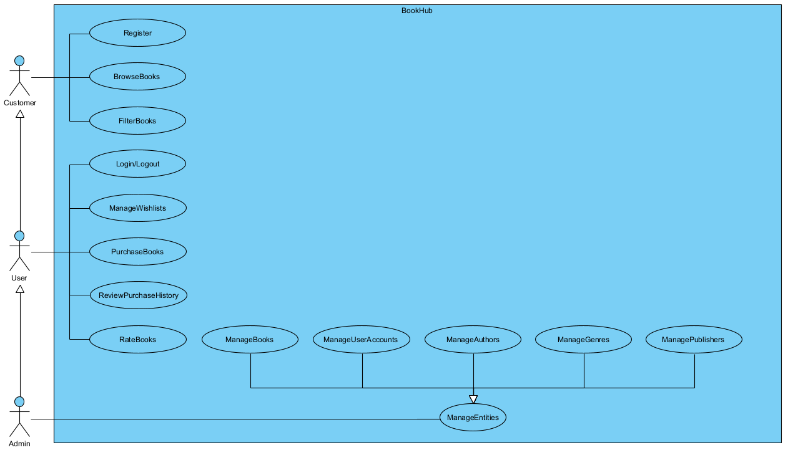
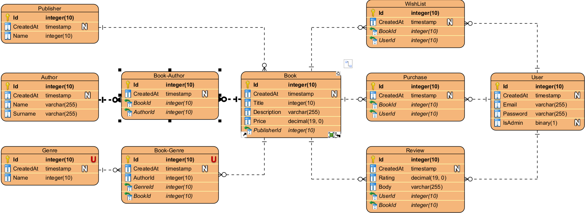

# [BookHub](https://gitlab.fi.muni.cz/xsabo1/pv179-bookhub)

BookHub is a C# Web API for managing books, authors, publishers, reviews, users, wishlists and orders.
It uses Entity Framework Core for data access, Mapster for object mapping, and Swagger (OpenAPI) for interactive API
documentation.

## Team Members

- [Samuel Sabo](https://gitlab.fi.muni.cz/xsabo1) (https://gitlab.fi.muni.cz/xsabo1)
- [Martin Gallik](https://gitlab.fi.muni.cz/xgallik) (https://gitlab.fi.muni.cz/xgallik)
- [Michal Novák](https://gitlab.fi.muni.cz/xnovak9) (https://gitlab.fi.muni.cz/xnovak9)

## Features

- Use-case diagram and data model included in documentation
- RESTful API to fetch products by name, description, price, category, and manufacturer
- CRUD operations for books, authors, publishers, reviews, users, wishlist items, and order items
- Database setup with a dedicated Data Access Layer (DAL)
- Database seeded with realistic data
- Error handling middleware
- Token-based authentication (hard-coded access token)
- Logging middleware for all incoming requests and outgoing responses
- Interactive API documentation with Swagger (OpenAPI)
- Team workflow with GitLab branching, merge requests, and code review
- Object mapping with Mapster

## Project Structure

### WebAPI Project ([`BookHub/`](./BookHub/))

- [`Controllers/`](./BookHub/Controllers) – API controllers for each entity
- [`Core/`](./BookHub/Core) – Core classes (e.g., error responses)
- [`Middlewares/`](./BookHub/Middlewares) – Custom middleware for logging, error handling and authentication
- [`Models/`](./BookHub/Models) – Data transfer objects (DTOs) and response models
- [`Program.cs`](./BookHub/Program.cs), [`appsettings.json`](./BookHub/appsettings.json), etc.

### DataAccessLayer Project ([`DataAccessLayer/`](./DataAccessLayer/))

- [`Entities/`](./DataAccessLayer/Entities) – Entity classes
- [`Migrations/`](./DataAccessLayer/Migrations) – Database migrations
- [`CustomDBContext.cs`](./DataAccessLayer/CustomDBContext.cs) – Database context
- [`DataInitializer.cs`](./DataAccessLayer/DataInitializer.cs) – Database seeding

### Shared Project ([`Shared/`](./Shared/))

- [`Exceptions/`](./Shared/Exceptions) – Custom exception classes

### BusinessLayer Project ([`BusinessLayer/`](./BusinessLayer/))

- [`DTOs/`](./BusinessLayer/DTOs) – Data transfer objects
- [`Facades/`](./BusinessLayer/Facades) – Facade classes for business logic
- [`Mappers/`](./BusinessLayer/Mappers) – Mapster mapping configurations
- [`Services/`](./BusinessLayer/Services) – Service classes for data access
- [`Services/Interfaces/`](./BusinessLayer/Services/Interfaces) – Service interfaces

### TestUtilities Project ([`TestUtilities/`](./TestUtilities/))

- [`Data/`](./TestUtilities/Data) – Test data for unit tests
- [`MockedObjects/`](./TestUtilities/MockedObjects) – Mocked objects for unit tests

### BusinessLayer.Tests Project ([`BusinessLayer.Tests/`](./BusinessLayer.Tests/))

- [`Services/`](./BusinessLayer.Tests/Services) – Unit tests for service classes

### MVC Project ([`MVC/`](./MVC/))

- [`Controllers/`](./MVC/Controllers) – MVC controllers for each entity
- [`Models/`](./MVC/Models) – View models for MVC views
- [`Views/`](./MVC/Views) – Razor views for rendering HTML pages
- [`wwroot/`](./MVC/wwwroot) - Static files (CSS, JS, images)

## Getting Started

### Prerequisites

- .NET 9.0 SDK
- SQL database (SQLite)

### Setup

#### A

1. Clone the [repository](https://gitlab.fi.muni.cz/xsabo1/pv179-bookhub)
2. Set up the project
    1. Local setup
        1. Navigate to the [`BookHub`](./BookHub) directory
            1. Restore dependencies
            2. Build the solution
        2. Do the same in directory [`MVC`](./MVC)
        3. Navigate to [root directory](./)
        4. Run database [migrations](./DataAccessLayer/Migrations) and seed the database
        5.
        6. ```shell
           dotnet ef database update --project DataAccessLayer --startup-project BookHub
           ```
        7. Run the WebAPI and MVC projects
    2. Docker compose setup
        1. Navigate to the [root directory](./)
        2. Build and run the docker compose
        3. ```shell
           docker-compose up --build
           ```
3. Authorize
    1. Using the hard-coded token: `very_secret_token`
    2. By creating an account in MVC application, then clicking on "Token" when logged in

## Usage

- The API is available
  at [http://localhost:5095](http://localhost:5095) / [https://localhost:5095](https://localhost:5095) (port specified
  in [`launchSettings.json`](./BookHub/Properties/launchSettings.json)) or if using docker
  compose [http://localhost:5000](http://localhost:5000)
- The MVC is available
  at [http://localhost:5047](http://localhost:5047) / [https://localhost:5047](https://localhost:5047) (port specified
  in [`launchSettings.json`](./BookHub/Properties/launchSettings.json)) or if using docker
  compose [http://localhost:5001](http://localhost:5001)
- Use the
  included [http swagger](http://localhost:5095/swagger/index.html) / [https swagger](https://localhost:5095/swagger/index.html) / [docker swagger](http://localhost:5000/swagger/index.html)
  or tools like Postman or curl to interact with the endpoints

## Technologies Used

- ASP.NET Core Web API
- Entity Framework Core
- Mapster
- xUnit for unit testing
- Docker for containerization
- Bogus for generating realistic test data
- Microsoft SQLite
- Swagger (Swashbuckle)
- Git and GitLab for version control and collaboration

## Technical documentation

The technical documentation provides an overview of the system architecture, use-case diagram, and data model.

### Diagrams

All diagrams are located in the [`Diagrams/`](./Diagrams) folder:

#### Use-Case Diagram



* A Customer should be able to register himself, thereby becoming a User
* A Customer should also be able to browse the catalog of Books, including the books related Authors, Genres, Reviews
  and Publisher
* A Customer should be able to filter in the catalog by its title, description, price range, min avg reviews, authors,
  genres and
  publisher


* A User should be able to Log in and Log out
* A User should be able to manage his Wishlist, including adding Books to it
* A User should be able to purchase Books, thereby creating an Order
* A User should be able to review his purchase history
* A User should be able to write Reviews for Books

* An Admin should be able to manage (CRUD) the catalog of Books, Authors, Genres, Publishers and other User Accounts

#### Data Model (ER Diagram)



* We decided to use integer primary keys for all entities for simplicity and consistency
* Each Entity has a created at attribute to track when the record was created
* The User entity has a role attribute to distinguish between regular users and admins
* We decided to use connecting tables to represent many-to-many relationships, such as between Books and Authors

### Overview

- The application follows a layered architecture, separating the WebAPI and DataAccessLayer projects.
- The WebAPI project handles HTTP requests, authentication, logging, and error handling.
- The DataAccessLayer project manages database entities, context, migrations, and seeding.
- Entity Framework Core is used for ORM and database migrations.
- Mapster is used for object mapping between entities and DTOs.

For detailed diagrams and further explanation, see the [`Diagrams/`](./Diagrams) folder.
